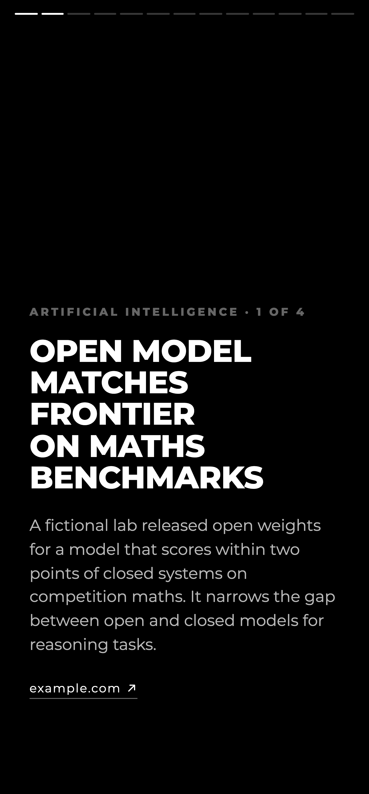
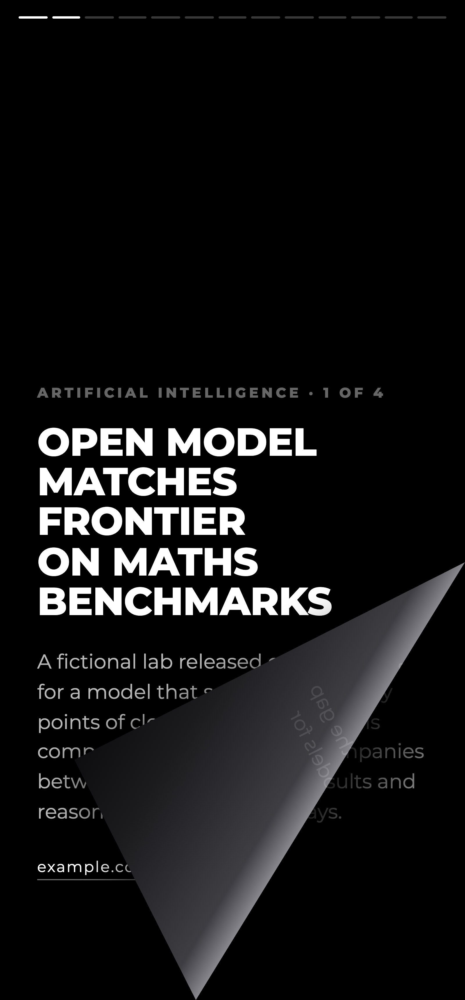
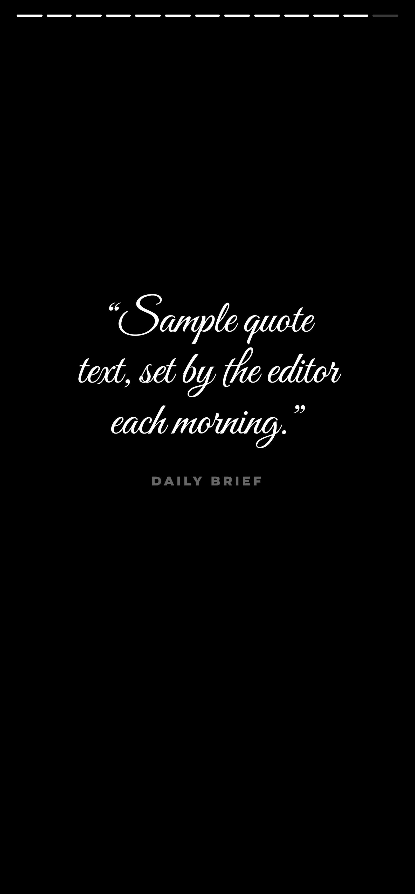

# Daily Brief

A four-minute morning paper for your phone: ten stories from public RSS feeds, picked and summarised by
Claude, read one page at a time with a page turn that follows your finger. A static site on Cloudflare
Workers. No accounts, no tracking, no backend.


## Why

News apps are built to keep you scrolling. A paper ends. This one builds a single edition each morning
(four AI stories, four world stories, one long read, one piece of good news and a quote) and then says
"That's today."

## What it does

- **Builds an edition from 15 feeds.** `build.mjs` pulls The Verge, TechCrunch, Ars Technica, MIT Technology
  Review, Hacker News, BBC, NPR, Al Jazeera, The Guardian, Aeon, Longreads, Quanta, Positive News, Good News
  Network and Smithsonian, keeping only fresh items (36 h for AI, 24 h for world, longer for long reads).
- **Lets Claude edit, not invent.** Claude (via the Agent SDK, Sonnet) picks stories by id and writes a
  headline and a two-sentence summary from the feed text only. Links, sources and images always come from
  the feed, never from the model, and cards that point at an unknown id are dropped.
- **Turns pages like paper.** The page is clipped along the fold line and a mirrored copy is laid over it,
  so the corner follows your finger, casts a shadow and curls on a diagonal. Tap the edges or use the
  arrow keys if you would rather not drag.
- **Works offline.** A network-first service worker keeps the last edition, and the page remembers where you
  stopped in it.
- **Installs to the home screen** as a PWA with its own icon.

## Screenshots

| | |
|---|---|
|  |  |
| Cover | Story |
|  |  |
| Turn | Quote |

*Screenshots use the made-up edition in `Tools/sample-edition.json`, so none of the stories are real.*

## Quick start

Requirements: Node 22+, and a Claude Code login for `npm run build`.

```sh
npm install
cp Tools/sample-edition.json public/edition.json   # or: npm run build, for today's real edition
npm run dev                                        # http://localhost:6262
```

To publish, put your Cloudflare account id in `.env` (copy `.env.example`), then run `npm run publish`.
It builds today's edition and deploys it. Run it from a daily scheduled job to get a new paper each morning.

## Requirements

| | |
|---|---|
| Runtime | Node 22+ |
| Editor | `@anthropic-ai/claude-agent-sdk`, signed in to Claude Code |
| Hosting | Cloudflare Workers static assets (`wrangler`) |
| Reader | Any modern mobile browser; desktop works with the arrow keys |

## How it's organised

```
build.mjs              fetch feeds, ask Claude for the edition, write public/edition.json
test.mjs               RSS and Atom parser checks
public/index.html      the reader: rendering, page-turn maths, gestures
public/sw.js           offline cache
wrangler.jsonc         static-assets Worker
Tools/                 sample edition and the screenshot script
```

See [docs/ARCHITECTURE.md](docs/ARCHITECTURE.md) for how the page turn works and
[docs/BUILDING.md](docs/BUILDING.md) for running, changing feeds and regenerating screenshots.

## Limitations

- Feeds are parsed with regular expressions. That holds up for these feeds, but a strange one may need a real XML parser.
- Images are hot-linked from publishers and can disappear. Cards without an image are plain black.
- The edition is only as fresh as the last `npm run build`.

## Contributing

- `npm test` checks the feed parser. `node Tools/screenshots.mjs` re-renders the screenshots in about five seconds.
- To add a feed, add its URL to the right section of `FEEDS` in `build.mjs`.
- Use the sample edition for demos and screenshots. Never commit a real `public/edition.json`.
- Good first projects: a light theme, per-section feed settings, a "yesterday" link.

## Credits and licence

Daily Brief is MIT licensed, see [LICENSE](LICENSE).
Fonts: [Montserrat](https://github.com/JulietaUla/Montserrat) and
[Great Vibes](https://github.com/googlefonts/great-vibes), both SIL Open Font License 1.1
([licenses/OFL.txt](licenses/OFL.txt)).
Stories, headlines and images belong to their publishers. The app links to the original article on every card.
